<!-- Generated from the ion_gym user manual and the shipped decks and notebooks. Edits made here are overwritten. -->

# 13. Dashboard reference (tab by tab)

Every control below is documented from the application itself: the UI harvester walks the live widget tree and emits this section from the widgets' own description strings, so this section cannot drift from the app. Hover any control in the dashboard for the same text.

## Load

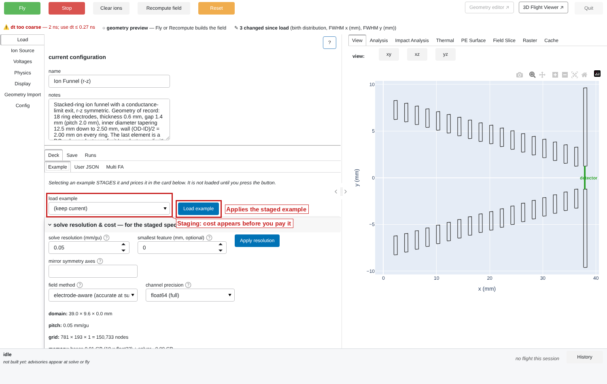

*Load tab, Deck \> Example: the example loader. Selecting an example STAGES it and shows its cost BEFORE you commit; Load example applies it. The Load tab is first in the rail because a session starts by choosing a deck.*

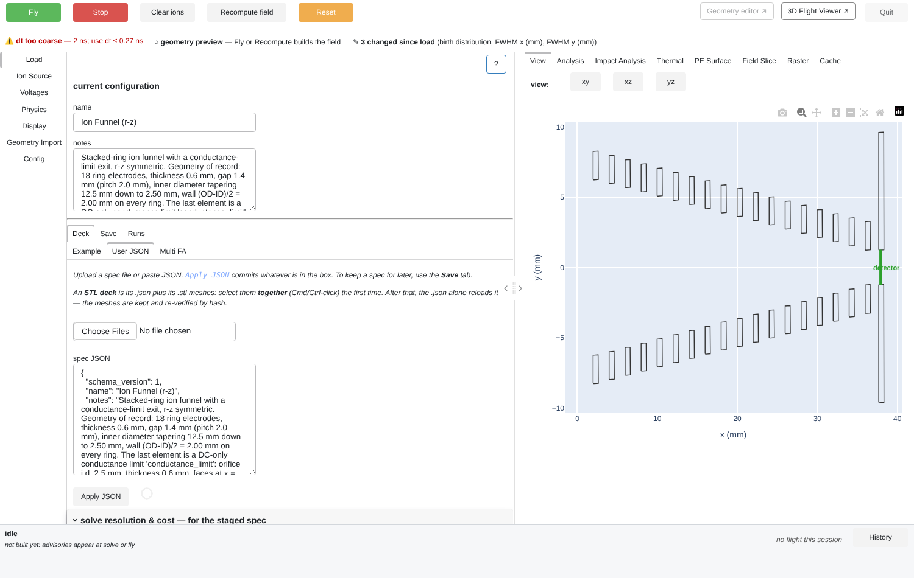

*Load tab, Deck \> User JSON: paste or upload a deck of your own. The JSON box always holds the live specification.*

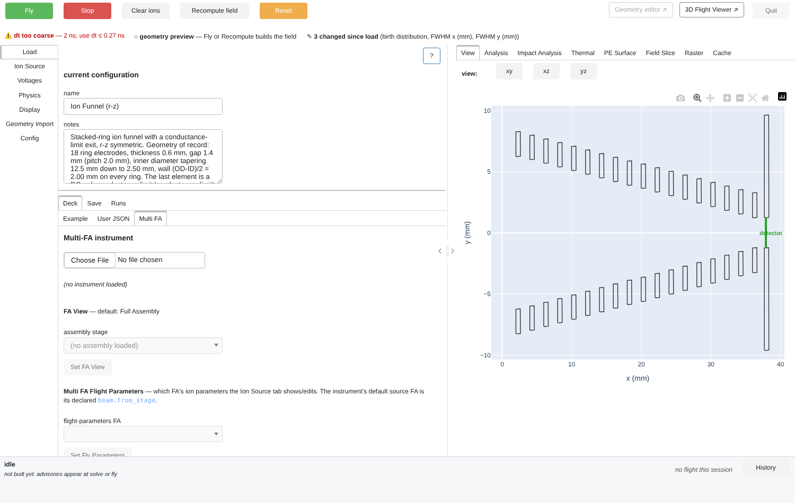

*Load tab, Deck \> Multi FA: staged assemblies -- each stage solves in its own grid and hands the ion across a declared seam. The cost card and specification summary appear only once an instrument is loaded.*

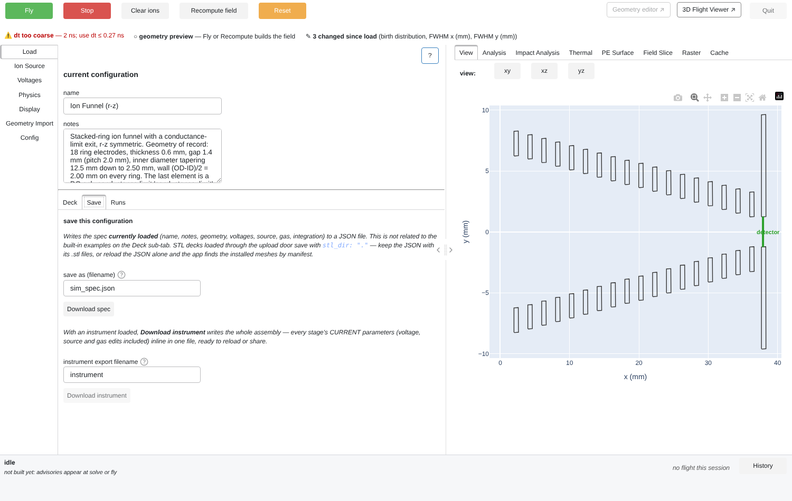

*Load tab, Save: writes the specification currently loaded to a JSON file. With an instrument loaded, Download instrument writes the whole assembly with every stage's current parameters in one file.*

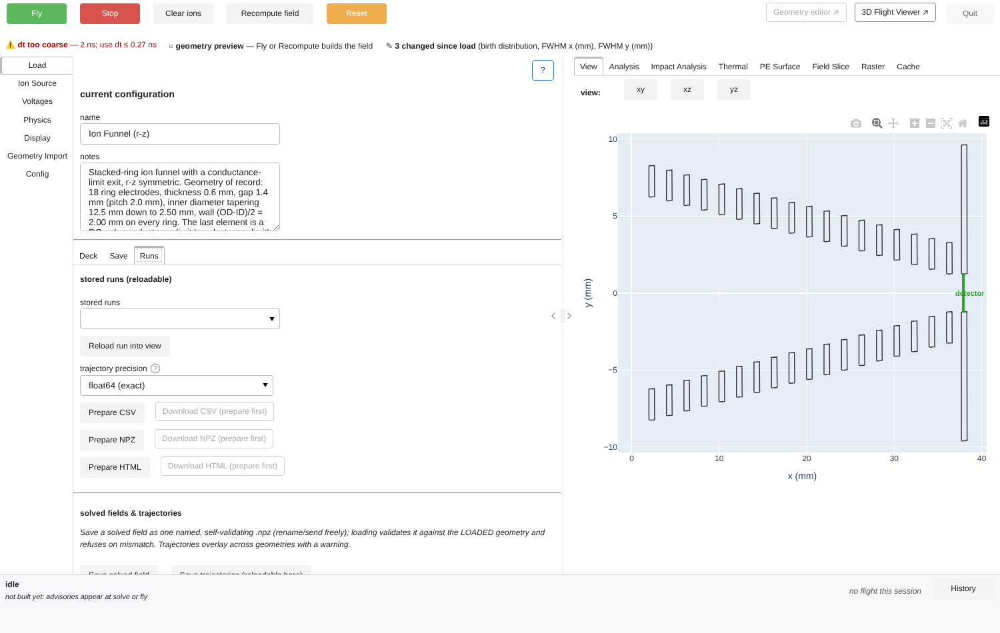

*Load tab, Runs: stored runs (reloadable), saved solved fields and trajectories, and maintenance (free memory, force a fresh solve).*

**current configuration**

- **name (TextInput)**

- **notes (TextAreaInput)**

- **load example (Select)**

- **Load example (Button)**

- **spec JSON (TextAreaInput)**

- **Apply JSON (Button)**

**Multi-FA instrument**

**FA View — default: Full Assembly**

- **assembly stage (Select)**

- **Set FA View (Button)**

- **flight-parameters FA (Select)**

- **Set Fly Parameters (Button)**

**solve target — which stage Recompute acts on**

- **solve (Select)**

- **solve resolution (mm/gu) (FloatInput) —** Grid pitch for the field solve. Smaller = finer = costlier (nodes scale as pitch^-3 in 3-D).

- **smallest feature (mm, optional) (FloatInput) —** The narrowest gap/slot you care about. Used ONLY to warn when the pitch cannot resolve it (\<~3 cells).

- **Apply resolution (Button)**

- **mirror symmetry axes (MultiChoice) —** Reflecting-boundary symmetry planes. Each axis listed means the stored grid is HALF the domain (mirror plane at the low face) — the solver halves the work per axis and the field unfolds to the full instrument. Declare an axis ONLY when the geometry is truly symmetric about that plane and the electrodes sit against it. Changing this re-solves.

- **field method (Select) —** How E is differenced from the potential. Electrode-aware corrects the field at metal surfaces (essential when ions ride close to electrodes, e.g. a surface-born TOF source). Plain gradient skips that pass — faster, and correct when ions stay off the surfaces (e.g. SLIM central-gap transport).

- **channel precision (Select) —** Stored precision of the drive-channel field stacks. float32 halves their memory (matters as grids grow); the gradient is always computed in float64, only storage changes.

**spec summary (live)**

- **save as (filename) (TextInput) —** Filename for the downloaded configuration. Include the .json extension (added if omitted).

- **Download spec (FileDownload)**

- **instrument export filename (TextInput) —** Filename for Download instrument; .json is appended if missing. Loading an instrument resets this to the document's own name.

- **Download instrument (FileDownload) —** The loaded multi-stage instrument document (section 10).

**stored runs (reloadable)**

- **stored runs (Select)**

- **Reload run into view (Button)**

- **trajectory precision (Select) —** Precision of Save trajectories and Download NPZ. float64 is exactly what was flown; float32 has ~7 significant digits and is about half the size, with the time column kept at float64.

- **Prepare CSV (Button) —** Build a CSV of the displayed run (one row per recorded step, full float64, plus ion index and fate) in the background, then enable its Download button.

- **Prepare NPZ (Button) —** Rebuild the trajectory file of the displayed run, at the precision chosen beside it: the same file Save trajectories writes, which Load as run and notebooks read. It is prepared automatically when a run settles; this button is for a retry.

- **Prepare HTML (Button) —** Snapshot the CURRENT view (field / PE surface + trajectories) with the full run metadata into one self-contained HTML file, built in the background.

- **Save solved field (Button) —** Save the loaded deck's solved field into the fields folder as \<deck\>\_\_\<key\>.field.npz with the deck's JSON beside it, in the background: the same file notebooks write with field_io.save_field, on every route. Safe to rename or send.

- **Save trajectories (reloadable here) (Button) —** Save the ACTIVE run's ion paths to this app's store as a named .traj.npz; reload it with 'Load as run' or open it in notebook 05. Stays server-side; progress and the save path are shown under the export buttons. For a file to take elsewhere, use Download NPZ or Download CSV above.

- **saved fields (Select)**

- **↻ (Button) —** Rescan the fields folder.

- **Load field (Button) —** Validate the selected field against the LOADED geometry and reinstate it into the cache. Refuses on any mismatch — a wrong-geometry field is silently wrong physics.

- **Open saved field (Button) —** One-file session open: reconstruct the geometry + operating point from the file's embedded spec, load it into the editor as if you had pasted the JSON, then validate and reinstate the bases. Refuses pre-bootstrap saves (no embedded spec) with the reason.

- **label (TextInput) —** Local display label for the selected field (stored in the registry; never rewrites the npz).

- **Relabel (Button) —** Apply the label to the selected field (local registry only).

- **saved trajectories (Select)**

- **Load as run (Button) —** Load the selected trajectory file as a stored run (overlays even across geometries, with a warning).

- **Clear stored runs now (Button)**

- **Clear field cache (Button)**

Fly assembly (top bar) flies the loaded instrument: stages solve or cache-hit, the packet is generated from the declared beam, and progress streams to the status line from a worker thread. The result reads detected / flown with named reasons for the rest (section 10); the record guard prices the retained trajectory subset before any ion flies.

## Ion Source

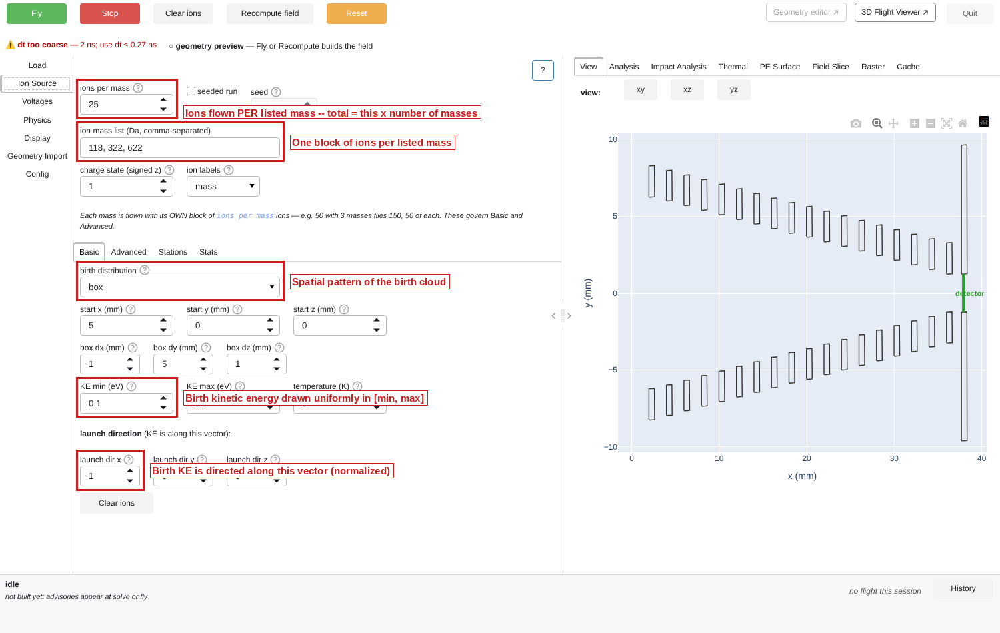

*Ion Source tab, box birth distribution (the default): ions are placed uniformly inside a rectangular volume whose extents are the box dx/dy/dz fields.*

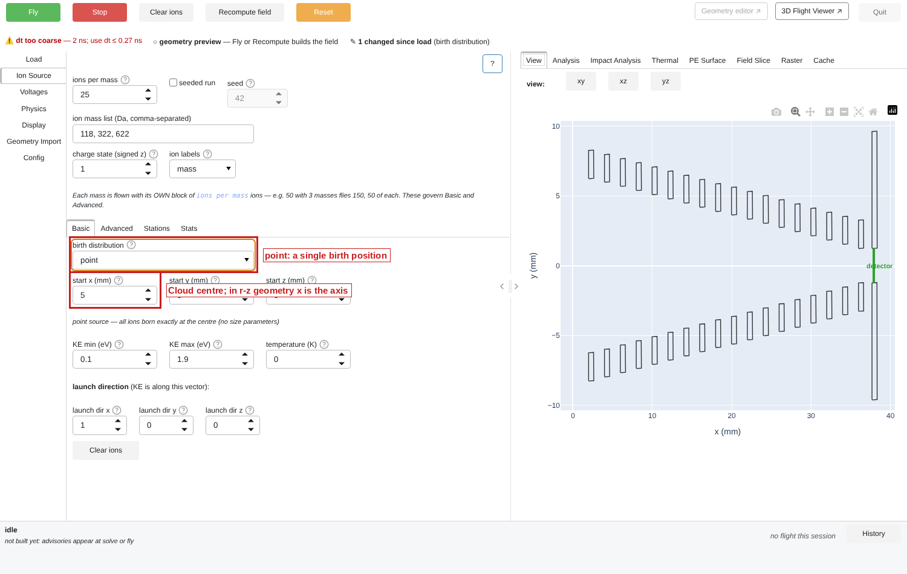

*Ion Source tab, point birth distribution: zero declared extent, so downstream spread is set entirely by the optics (the app prints a point-source advisory for exactly this case).*

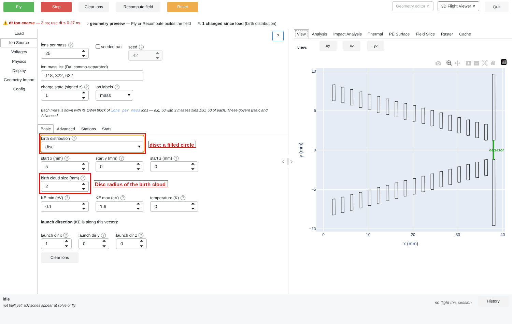

*Ion Source tab, disc birth distribution: a filled disc of the given radius around the start position.*

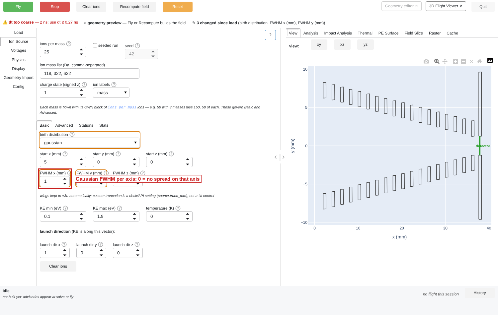

*Ion Source tab, gaussian birth distribution: per-axis FWHM; truncation is derived at 3 sigma -- an untruncated Gaussian is a different beam, and the derived cut removes the wings without another knob.*

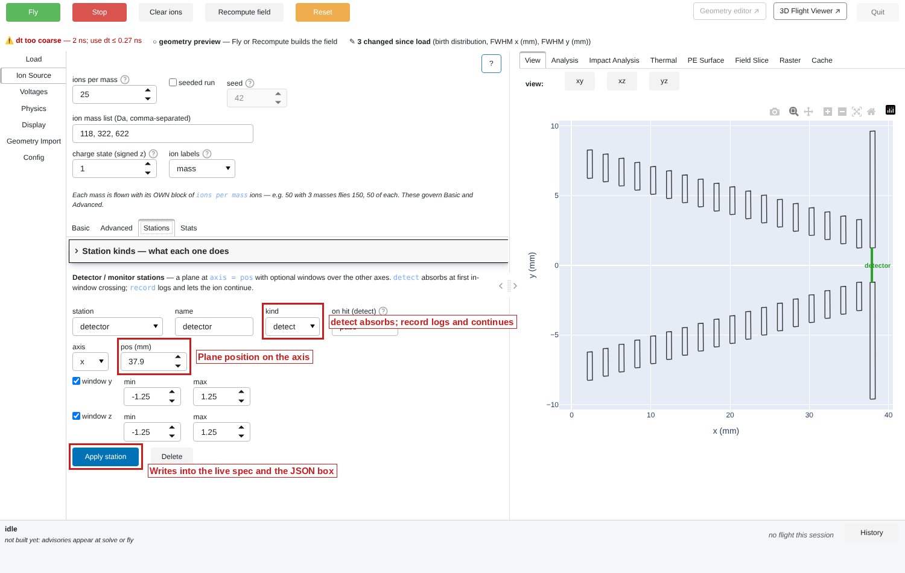

*The station editor (Ion Source \> Stations): a detector or aperture plane at axis = pos with optional windows over the other two axes. Kind detect carries on hit: pass logs the first in-window crossing and the ion continues; splat absorbs it there (fate 6). Kind impact_plane is a plate: in-window passes through the aperture, outside splats (fate 5), and an empty window is a wall. Apply station writes into the live specification and the JSON box.*

- **ions per mass (IntInput) —** Ions flown PER listed mass. Total flown = this x the number of masses. E.g. 50 with 4 masses flies 200 ions (50 of each).

- **seeded run (Checkbox)**

- **seed (IntInput) —** Pins the whole run: births, birth times and collision draws. Ion i always draws the same numbers, so reruns are bit-identical and two tunes are compared on common random numbers. Unchecked (default): fresh entropy per run, drawn seed printed.

- **ion mass list (Da, comma-separated) (TextInput) —** Masses in daltons, not mass-to-charge: charge is the separate field below.

- **charge state (signed z) (IntInput) —** Signed integer charge state for every ion in the packet (spec source.charge). 0 refuses at fly time.

- **ion labels (Select) —** Name each species in legends, filters and stats by its mass in Da (default) or by *m/z* = mass/\|z\|. Display only: the deck always stores masses. Not saved between sessions.

- **birth distribution (Select) —** Spatial pattern the ions are seeded over: a single point, a filled disc, a line, a grid, or a BOX (random uniform placement inside a rectangular volume -- avoids the skew of a contrived single-point source; extents set below).

- **start x (mm) (FloatInput) —** Birth position of the ion cloud center, x (mm). In r-z geometry x is the axis.

- **start y (mm) (FloatInput) —** Birth position of the ion cloud center, y (mm). In r-z geometry y is the radius.

- **start z (mm) (FloatInput) —** Birth position z (mm) — relevant for 3-D scenes.

- **box dx (mm) (FloatInput) —** Full extent (mm) of the birth box along this axis, centerd on (start x, y, z); each ion is placed uniformly at random inside. 0 collapses that axis.

- **box dy (mm) (FloatInput) —** Full extent (mm) of the birth box along this axis, centerd on (start x, y, z); each ion is placed uniformly at random inside. 0 collapses that axis.

- **box dz (mm) (FloatInput) —** Full extent (mm) of the birth box along this axis, centerd on (start x, y, z); each ion is placed uniformly at random inside. 0 collapses that axis.

- **KE min (eV) (FloatInput) —** Lower bound of the birth kinetic energy; each ion draws uniformly in \[min, max\]. Set equal for monoenergetic.

- **KE max (eV) (FloatInput) —** Upper bound of the birth kinetic energy.

- **temperature (K) (FloatInput) —** Isotropic Maxwell-Boltzmann thermal spread of the birth velocities: each lab axis gets an independent Gaussian kick with sigma = sqrt(kT/m), SUPERPOSED on the directed beam KE, the per-axis dv FWHM, and the drift terms (a beam AT a temperature). 0 = off: an idealized, perfectly cold beam with NO thermal scatter. In a TOF that deletes the turn-around term — usually the resolution-limiting aberration of an OA source — so a 0 K TOF resolution is optimistic by construction. Real beams are also rarely isotropic: for an OA-MRT use the per-axis dv FWHM (m/s) instead, which sets each axis's effective temperature independently.

**launch direction (KE is along this vector):**

- **launch dir x (FloatInput) —** Launch direction vector (the birth KE is directed along this; it is normalized, so only the direction matters, not the magnitude). e.g. (0,0,1) fires along z.

- **launch dir y (FloatInput) —** Launch direction vector (the birth KE is directed along this; it is normalized, so only the direction matters, not the magnitude). e.g. (0,0,1) fires along z.

- **launch dir z (FloatInput) —** Launch direction vector (the birth KE is directed along this; it is normalized, so only the direction matters, not the magnitude). e.g. (0,0,1) fires along z.

- **Clear ions (Button) —** Clear the flown ions from the view (same as the top-bar Clear ions).

**Beam declaration**

Below the birth-cloud controls sits the beam declaration: a compact statement of the packet as a beam. It fixes the ion count and seed, names the propagation axis, and then gives one row per phase-space channel — the two transverse positions, the three direction components, the kinetic energy and the birth time. Every row has the same shape: a distribution chooser and its one or two parameters, so declaring a beam reads as a table of channels rather than a scatter of boxes. Regenerate beam draws a fresh packet from the declaration; Derive from current packet runs the other direction, fitting the declaration to whatever packet is currently loaded — the usual way to turn a flown arrival distribution into the birth condition of the next stage.

The station editor follows (Ion Source \> Stations), with the section-7.5 vocabulary: kind detect with on hit pass or splat, kind impact_plane for plates, windows over the two transverse axes. Apply station writes into the live specification and the JSON box, so a save persists it. Last, the Stats sub-tab selectors choose which population the statistics table describes: which surface, which transmitted fate, and which plane the impact cross-section is taken in.

## Voltages

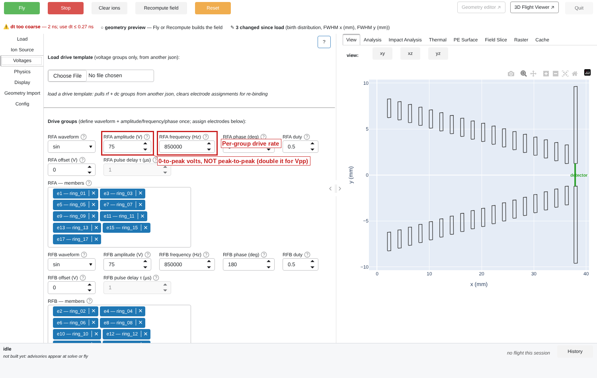

*Voltages tab, drive groups: waveform, amplitude, frequency, phase and members are defined once per group; electrodes are assigned below.*

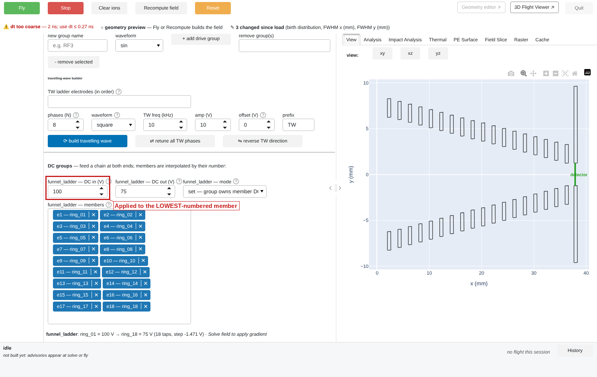

*Voltages tab, DC ladder groups: feed a chain at both ends and members are interpolated by their explicit number -- order is never parsed from names.*

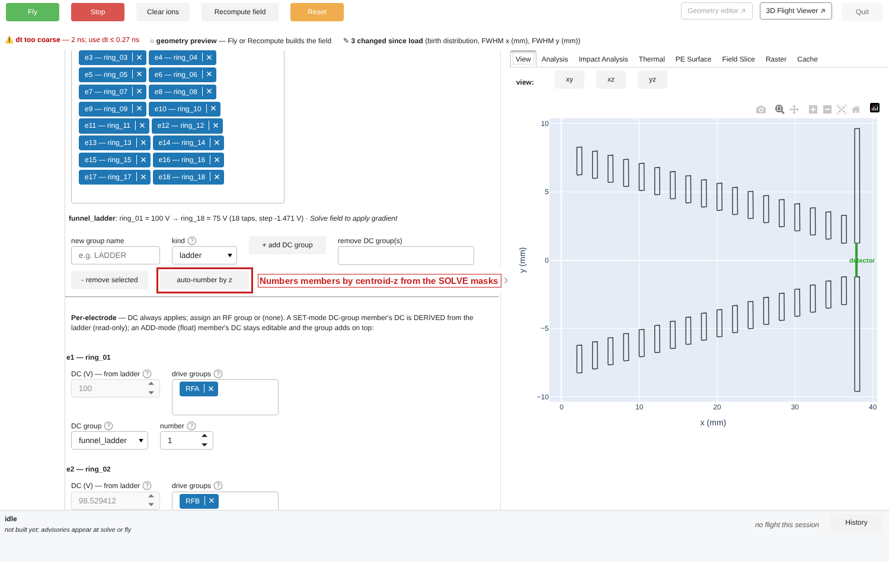

*Voltages tab, ladder numbering: auto-number by z orders members by centroid-z straight from the SOLVE masks -- it needs a solved field and refuses rather than guessing.*

**Load drive template (voltage groups only, from another json):**

**Drive groups (define waveform + amplitude/frequency/phase once; assign electrodes below):**

- **RFA waveform (Select) —** Drive waveform for this group. 'table' is the general sampled shape (arbitrary); analytic shapes are sin/square (triangle/sawtooth extensible).

- **RFA amplitude (V) (FloatInput) —** Drive amplitude, 0-to-peak volts (a value of 100 here means 200 V peak-to-peak).

- **RFA frequency (Hz) (FloatInput) —** Drive frequency for this group, in Hz. For a stepped traveling wave this is the per-group rate.

- **RFA phase (deg) (FloatInput) —** Phase offset of this group's waveform. A traveling wave is groups stepped in phase; two confinement rails run 180 deg apart.

- **RFA duty (FloatInput) —** Square waves only: fraction of the period HIGH (0.5 = 11110000 across 8 stepped phases; 0.25 = 11000000).

- **RFA offset (V) (FloatInput) —** Static DC offset added to this group's waveform: V(t) = amplitude\*shape(t) + offset (volts). Folds into the static field. Amplitude 0 with a non-zero offset is a pure DC electrode.

- **RFA pulse delay τ (µs) (FloatInput) —** Step-table drives only: the waveform holds 0 until τ, then 1 (× amplitude). This is Wiley-McLaren delayed extraction when it drives the pusher/extraction plates. NOTE: τ is co-tuned with the mirror detune — changing τ alone moves the velocity focus off the detector. Non-step tables are read-only here.

- **RFA — members (MultiChoice) —** Electrodes driven by this group. Same as the per-electrode 'drive groups' box; an electrode may be in several drive groups and a DC group.

- **RFB waveform (Select) —** Drive waveform for this group. 'table' is the general sampled shape (arbitrary); analytic shapes are sin/square (triangle/sawtooth extensible).

- **RFB amplitude (V) (FloatInput) —** Drive amplitude, 0-to-peak volts (a value of 100 here means 200 V peak-to-peak).

- **RFB frequency (Hz) (FloatInput) —** Drive frequency for this group, in Hz. For a stepped traveling wave this is the per-group rate.

- **RFB phase (deg) (FloatInput) —** Phase offset of this group's waveform. A traveling wave is groups stepped in phase; two confinement rails run 180 deg apart.

- **RFB duty (FloatInput) —** Square waves only: fraction of the period HIGH (0.5 = 11110000 across 8 stepped phases; 0.25 = 11000000).

- **RFB offset (V) (FloatInput) —** Static DC offset added to this group's waveform: V(t) = amplitude\*shape(t) + offset (volts). Folds into the static field. Amplitude 0 with a non-zero offset is a pure DC electrode.

- **RFB pulse delay τ (µs) (FloatInput) —** Step-table drives only: the waveform holds 0 until τ, then 1 (× amplitude). This is Wiley-McLaren delayed extraction when it drives the pusher/extraction plates. NOTE: τ is co-tuned with the mirror detune — changing τ alone moves the velocity focus off the detector. Non-step tables are read-only here.

- **RFB — members (MultiChoice) —** Electrodes driven by this group. Same as the per-electrode 'drive groups' box; an electrode may be in several drive groups and a DC group.

- **new group name (TextInput)**

- **waveform (Select) —** square = classic stepped SLIM TW; sin = sinusoidal TW.

- **+ add drive group (Button)**

- **remove group(s) (MultiChoice)**

- **- remove selected (Button)**

**traveling-wave builder**

- **TW ladder electrodes (in order) (MultiChoice) —** Ordered electrodes the wave travels along. Order is the wave direction; phase steps one electrode per segment. Assignment is cyclic (electrode j -\> phase j mod N), so any number of segments needs only N groups.

- **phases (N) (IntInput) —** Number of distinct phases (4 and 8 are common SLIM).

- **waveform (Select) —** square = classic stepped SLIM TW; sin = sinusoidal TW.

- **TW freq (kHz) (FloatInput)**

- **amp (V) (FloatInput)**

- **offset (V) (FloatInput) —** DC offset of the drive. 0 = bipolar, +/-amp about ground. For a unipolar 0..V SLIM drive set amp V/2 and offset V/2 (e.g. amp 25, offset 25 -\> 0..50 V).

- **prefix (TextInput)**

- **⟳ build travelling wave (Button)**

- **⇄ retune all TW phases (Button) —** Apply the amp / freq / waveform / offset above to EVERY phase group of the existing ladder at once, keeping each group's phase. Use after 'build traveling wave' to change the drive with one edit instead of N.

- **⇋ reverse TW direction (Button) —** Negate every phase of the ladder with this prefix, flipping the wave's travel direction. A drive-side change: cache hit, no re-solve. Press again to restore the original direction.

**DC groups — feed a chain at both ends; members are interpolated by their number:**

- **funnel_ladder — DC in (V) (FloatInput) —** Applied to the member with the LOWEST number.

- **funnel_ladder — DC out (V) (FloatInput) —** Applied to the member with the HIGHEST number. A RE-WEIGHT, not a re-solve: cache hit.

- **funnel_ladder — mode (Select) —** set: member DC is DERIVED from the group (ladder/divider). add: the group's value is ADDED on top of each member's own DC (a float rail) — member DC stays editable. Either way a change is a re-weight, never a re-solve.

- **funnel_ladder — members (MultiChoice) —** Electrodes in this DC group. Editing here is the same as the per-electrode 'DC group' dropdown — an electrode may also be in a drive group at the same time.

- **new group name (TextInput)**

- **kind (Select) —** ladder = two-end interpolated divider (set DC in / DC out and a number per member). uniform = one voltage on every member (no numbering needed).

- **+ add DC group (Button)**

- **remove DC group(s) (MultiChoice)**

- **- remove selected (Button)**

- **auto-number by z (Button) —** Number the members of each group in ascending centroid-z, straight from the SOLVE masks. Needs a solved field; refuses rather than guessing.

**e1 — ring_01 (and identically for every electrode)**

- **DC (V) — from ladder (FloatInput) —** Static (DC) potential on this electrode. In a SET-mode DC group this is DERIVED from the group's in/out and its number; in an ADD-mode (float) group it stays YOURS and the group's value is added on top at composition.

- **drive groups (MultiChoice) —** Assign this electrode to zero or MORE drive groups (multi-select). An electrode can carry a confinement RF and a traveling-wave AC at once, plus its DC.

- **DC group (Select) —** Ladder membership. DC and RF groups are independent — an electrode can be in both.

- **number (IntInput) —** Position in the ladder. EXPLICIT: order is never parsed from the name (E10 would sort before E9). DC in lands on the lowest, DC out on the highest.

The per-electrode block repeats identically for each electrode in the stack: its DC value (derived from the ladder when the electrode is a member), its drive-group memberships, its DC group and its explicit ladder number. Only the first is shown above; restating nineteen copies would document the layout, not the controls.

## Physics

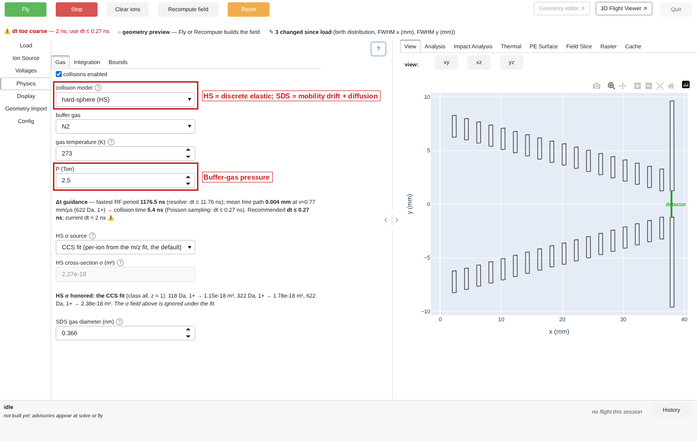

*Physics tab, Gas sub-tab: the collision model (HS hard-sphere or SDS diffusion), the buffer gas, its pressure and temperature. The dt guidance line underneath is live -- it derives the resolving and collision-sampling limits from the current gas and drive, and warns when the declared step is too coarse for either.*

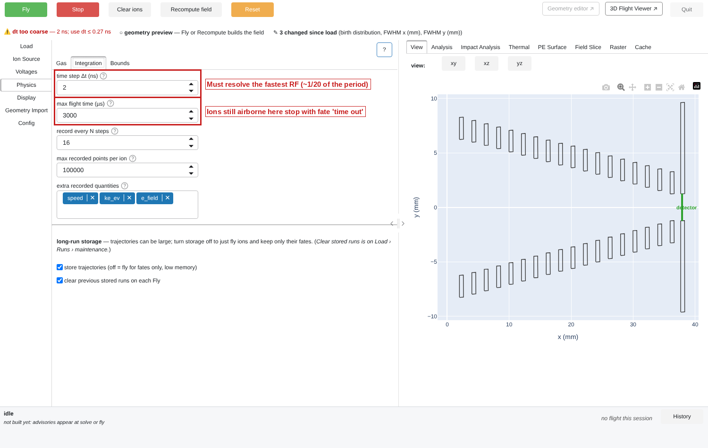

*Physics tab, Integration sub-tab: the integration time step and the flight-time ceiling. This is a separate capture because it is a separate sub-tab -- a callout can only box a control the reader can actually see.*

- **collisions enabled (Checkbox)**

- **collision model (Select) —** HS = discrete elastic hard-sphere collisions. SDS = the statistical diffusion model of Appelhans & Dahl (mobility-limited drift plus Einstein diffusion), for pressures where collisions are too frequent to sample; mobilities are declared per species or estimated from the ion's mass (docs/SDS_MODEL.md).

- **buffer gas (Select)**

- **gas temperature (K) (FloatInput) —** Buffer-gas temperature; sets the thermal velocity ions relax toward.

- **P (Torr) (FloatInput)**

- **HS σ source (Select) —** What sets the hard-sphere cross-section: the explicit σ below for every ion, or the CCS fit evaluated at each ion's mass (physics.ccs; N2 only, another gas falls back to the σ below with a warning). The readout underneath shows the value actually handed to the kernel either way.

- **HS cross-section σ (m²) (LiteralInput) —** Hard-sphere ion–neutral collision cross-section. Used only by the HS model, and only when the σ source above is 'fixed value'; larger σ = more frequent collisions. Typical N₂ value ≈ 2.3e-18 m².

- **SDS gas diameter (nm) (FloatInput) —** Neutral gas molecule diameter, used only by the SDS model: it converts mobilities between gases (hard-sphere ratio) and enters the mass-based mobility estimate for a gas other than air. Air ≈ 0.366 nm.

- **time step Δt (ns) (FloatInput) —** Integration time step. Smaller = more accurate but slower; it must resolve the fastest RF (rule of thumb ≈ 1/20 of the RF period, so ≈0.06 µs at 800 kHz).

- **max flight time (µs) (FloatInput) —** Longest an ion is flown. An ion still airborne at this time stops with fate 'time out'.

- **record every N steps (IntInput) —** Trajectory sampling interval: one point is stored every N integration steps. Larger = fewer stored points (smaller files, faster plots); it does NOT change the physics, only how densely the path is saved.

- **max recorded points per ion (IntInput) —** Trajectory buffer cap. When a flight needs more points than this the RECORDING stops but the ion keeps flying — the app warns before the fly and names the true stopping point afterwards. Raise this (or 'record every N') to capture a whole long flight.

- **extra recorded quantities (MultiChoice) —** Additional per-point values to store along each trajectory (e.g. field magnitude, collision count) for coloring or export.

- **store trajectories (off = fly for fates only, low memory) (Checkbox)**

- **clear previous stored runs on each Fly (Checkbox)**

- **x min on (Checkbox)**

- **x min (mm) (FloatInput)**

- **x max on (Checkbox)**

- **x max (mm) (FloatInput)**

- **y min on (Checkbox)**

- **y min (mm) (FloatInput)**

- **y max on (Checkbox)**

- **y max (mm) (FloatInput)**

- **z min on (Checkbox)**

- **z min (mm) (FloatInput)**

- **z max on (Checkbox)**

- **z max (mm) (FloatInput)**

## Display

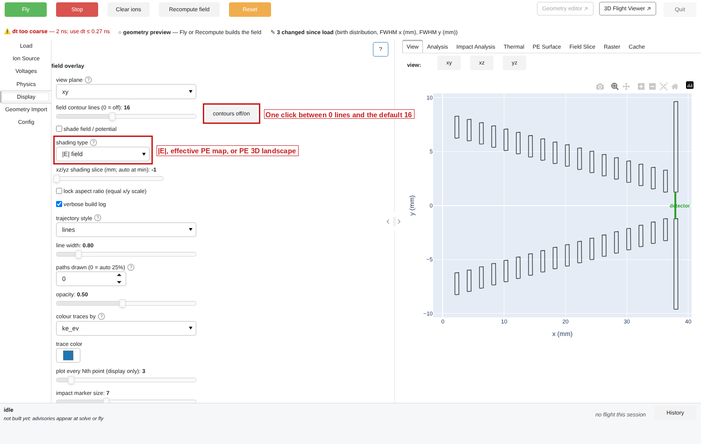

*Display tab: what the view pane draws and how. The field overlay block at the top drives the shading and its contour lines; the contour slider is the single value authority and the off/on button flips it between 0 and the default of 16.*

**field overlay**

- **view plane (Select) —** Which 2-D plane to project the trajectories and field onto for display.

- **field contour lines (0 = off) (IntSlider) —** The single value authority for the contour count; the button beside it flips between 0 and the default 16.

- **contours off/on (Button)**

- **shade field / potential (Checkbox)**

- **shading type (Select) —** What the shading shows: instantaneous field magnitude \|E\|, the effective RF pseudopotential (PE) as a 2-D map, or the PE as a 3-D landscape.

- **xz/yz shading slice (mm; auto at min) (FloatSlider)**

- **lock aspect ratio (equal x/y scale) (Checkbox)**

- **verbose build log (Checkbox)**

- **trajectory style (Select) —** Draw each ion path as connected lines, individual recorded points, or both.

- **line width (FloatSlider)**

- **paths drawn (0 = auto 25%) (IntInput) —** How many ion paths to draw, evenly strided across the packet. 0 keeps the automatic policy: all up to 25, then 25% of the packet. Statistics and impact markers always use every ion.

- **opacity (FloatSlider)**

- **colour traces by (Select) —** Color each trajectory by its outcome (fate), by mass (one color per species, with a legend named per the Ion Source 'ion labels' setting), a single color, or a recorded channel on the plasma scale. A channel draws no color bar, to keep the plot area free. A channel the run did not record colors by mass and says so.

- **trace color (ColorPicker)**

- **plot every Nth point (display only) (IntSlider)**

- **impact marker size (FloatSlider)**

- **impact marker symbol (Select) —** Marker shape drawn where an ion terminates on metal or a bounding plane.

- **electrode fills (Checkbox)**

- **electrode labels (Checkbox)**

- **electrode color (ColorPicker)**

- **electrode alpha (FloatSlider)**

- **Show field (no ions) (Button)**

## Geometry Import

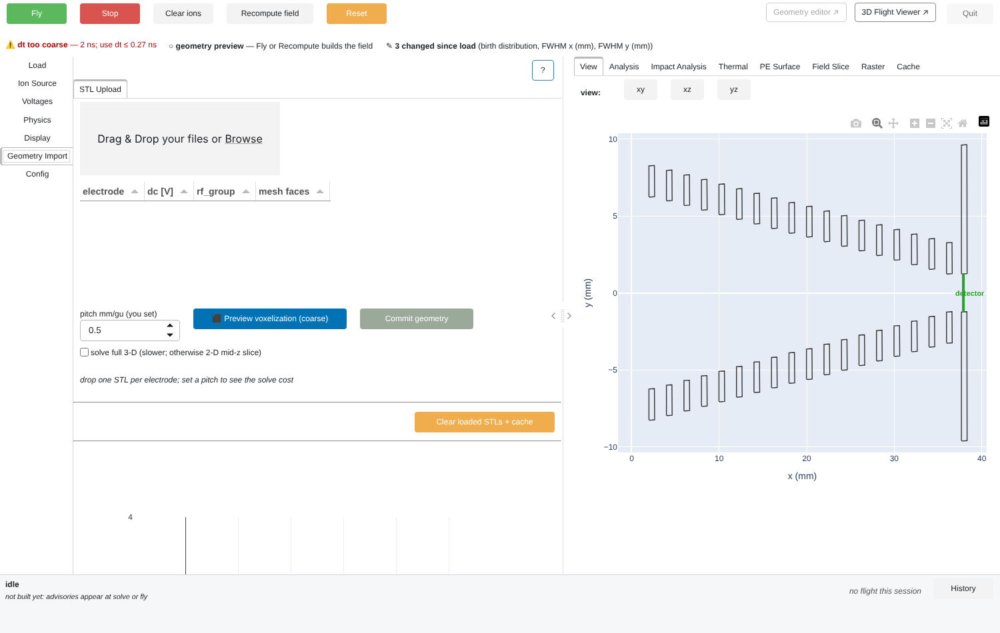

*Geometry Import tab: bring electrodes in from JSON or STL.*

- **pitch mm/gu (you set) (FloatInput)**

- **⬛ Preview voxelization (coarse) (Button)**

- **Commit geometry (Button)**

- **solve full 3-D (slower; otherwise 2-D mid-z slice) (Checkbox)**

- **Clear loaded STLs + cache (Button)**

## Config

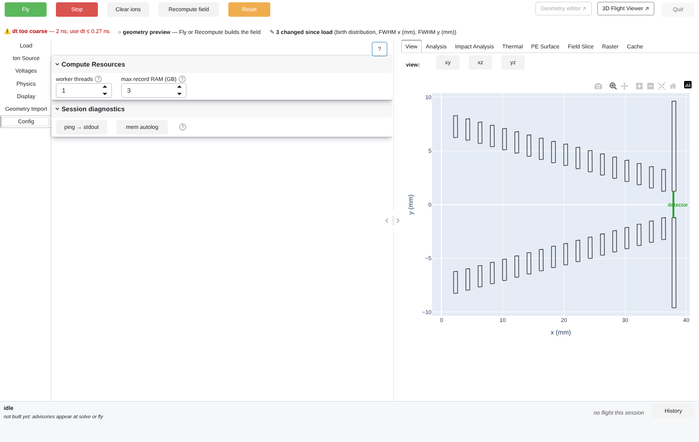

*Config tab: properties of this installation and session only. Compute Resources holds the worker count and the memory allowance for recorded trajectories; Session diagnostics answers whether the session is healthy. Neither travels with a deck or changes the physics.*

- **worker threads (IntInput) —** Ion-flight threads for the next Fly. Default leaves two cores for the app; 1 = the sequential legacy path. Results are seed-identical at any count.

- **max record RAM (GB) (IntInput) —** Memory the trajectory record may use. The Fly refuses above this and warns at half of it, using the quote shown in the sizing readout. 0 = derive from system RAM (8 GB detected). Storage only: rec_every changes what is kept, never what is computed.

- **ping → stdout (Button) —** Print one line to the SERVER console. If the UI feels wedged, a ping that appears means the kernel is alive and the browser tab is the problem; no line means the server is busy or stuck. Touches no state and cannot disturb a run.

- **mem autolog (Toggle)**

## View (plot pane)

**view:**

- **xy (Button)**

- **xz (Button)**

- **yz (Button)**

## Analysis (plot pane)

- **x axis (Select) —** Recorded channel for the horizontal axis.

- **y axis (Select) —** Recorded channel for the vertical axis.

- **data (Select) —** Plot every recorded point, one point per ion at its final state, or a histogram of the x-axis quantity over per-ion endpoints (y axis is ignored).

- **colour / trace by (Select) —** ion: a separate color per ion (cycling palette). all together: one series. fate: color by outcome. mass: one color per species — each ion is colored by its OWN flown mass (stable palette, sorted numerically, named in the legend per the 'ion labels' setting); works in all three plot modes.

- **style (Select)**

- **bins (IntInput) —** Histogram bin count. A good rule of thumb is about sqrt(number of ions); the default 20 suits ~50-400 ions. Only used in histogram mode.

- **mass filter (MultiChoice) —** Empty = ALL species flown (default). Pick one or more to plot only those ions. Options come from the displayed run's FLOWN ions (each ion's own recorded mass), named per the 'ion labels' setting, not from the editor — so a reloaded older run offers what it actually flew.

- **colour scheme (Select) —** Palette for line/marker colors — applies to per-ion cycling, mass coloring (stable assignment over sorted masses), and the all-together series. Fate colors stay fixed: they are semantic (impact/alive/timeout), not aesthetic.

- **alpha (opacity of lines/markers/bars) (FloatSlider)**

- **Plot (Button)**

- **Export plotted data (CSV) (FileDownload)**

## Impact Analysis (plot pane)

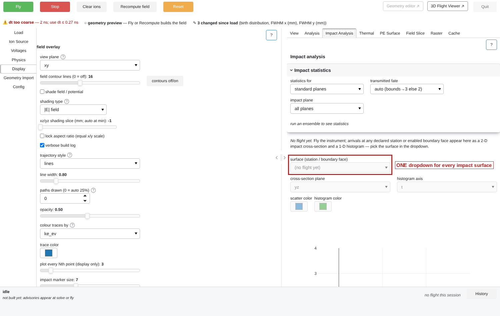

*Impact Analysis tab before any flight: the surface dropdown enables once arrivals exist. Stations and enabled boundary faces share one stream and one naming authority (enabled_planes), so the dropdown and the stats table can never disagree. Single-stage flights and assemblies both feed it: station crossings from the kernels, assembly detections in world coordinates.*

**Impact analysis**

- **statistics for (Select)**

- **transmitted fate (Select)**

- **impact plane (Select)**

- **surface (station / boundary face) (Select)**

- **cross-section plane (Select)**

- **histogram axis (Select)**

- **scatter color (ColorPicker)**

- **histogram color (ColorPicker)**

## Thermal (plot pane)

- **T_slope tail-fit percentile (FloatSlider)**

- **bins (IntInput) —** Histogram bins for the velocity and energy distributions.

- **Assess temperature (Button)**

- **ions (IntInput)**

- **cell size (mm) (FloatInput)**

- **hot threshold (eV; blank = 10 kT) (FloatInput)**

- **Map hot spots (Button)**

## PE Surface (plot pane)

- **ion mass (Da) (FloatInput)**

- **component (Select)**

- **plane (Select)**

- **slice position (mm; auto if at min) (FloatSlider)**

- **slice (mm, exact) (FloatInput)**

- **electrodes on the PE scale (Select)**

- **trust radius (cells from metal) (IntSlider)**

- **evaluate instant drives at a lab time (Checkbox)**

- **lab time t (µs) (FloatInput)**

- **set view angle / perspective (Checkbox)**

- **azimuth (°) (FloatInput)**

- **elevation (°) (FloatInput)**

- **distance (FloatInput)**

- **orthographic (Checkbox)**

- **drape current trajectories (Checkbox)**

- **drape scope (Select) —** Which part of each trajectory is draped on the sliced sheet. 'auto' reads the source's declared LAUNCH direction (source.direction): when that direction is normal to the plane it drapes whole paths, otherwise only points near the slice. A launch direction need not be the flight axis (a thermal or trapped cloud), so choose a scope by hand when it is not. The figure states the scope it used.

- **show title (Checkbox)**

- **show legend (Checkbox)**

- **height (z aspect) (FloatSlider)**

- **PE transform (optional) (Select)**

- **PE transform factor / asinh knee (eV) (FloatInput)**

- **resolution (pts/axis, ↓ = faster) (IntSlider)**

- **Compute surface (Button)**

- **Reset PE view (Button)**

## Field Slice (plot pane)

- **quantity (Select)**

- **ion mass (Da) (FloatInput)**

- **plane (Select)**

- **slice position (mm; auto if at min) (FloatSlider)**

- **slice (mm, exact) (FloatInput)**

**heatmap**

- **heatmap (Checkbox)**

- **heatmap colors (Select)**

- **log scale (Checkbox)**

- **range min (blank=auto) (FloatInput)**

- **range max (blank=auto) (FloatInput)**

**contours**

- **contours (Checkbox)**

- **\# contours (IntSlider)**

- **contour colors (Select)**

- **resolution (pts/axis, ↓ = faster) (IntSlider)**

- **lock aspect (true mm) (Checkbox)**

**view window (mm; blank = full domain)**

- **x min (blank=full) (FloatInput)**

- **x max (FloatInput)**

- **y min (blank=full) (FloatInput)**

- **y max (FloatInput)**

- **reset view (Button)**

- **Compute slice (Button)**

- **CSV filename (TextInput)**

- **⤓ export slice CSV (FileDownload)**

## Raster (plot pane)

- **Compute 3D View (Button) —** Render the labeled voxel grid the SOLVER consumes (route-agnostic: scene CSG, STL voxelization). Multi-axis: 3-D cloud + exact xy/xz/yz projections.

- **show electrodes (Checkbox)**

- **show legend (Checkbox)**

## Cache (plot pane)

**Cache location: ~/.ion_gym_cache by default (the ION_GYM_CACHE environment variable moves it); entries listed with their size on disk**

- **↻ refresh (Button)**

- **🗑 clear ALL field cache (Button)**

- **entry to remove (Select)**

- **✕ remove selected (Button)**

- **export to (TextInput)**

- **⇩ export selected (field + spec json) (Button)**

## Status bar

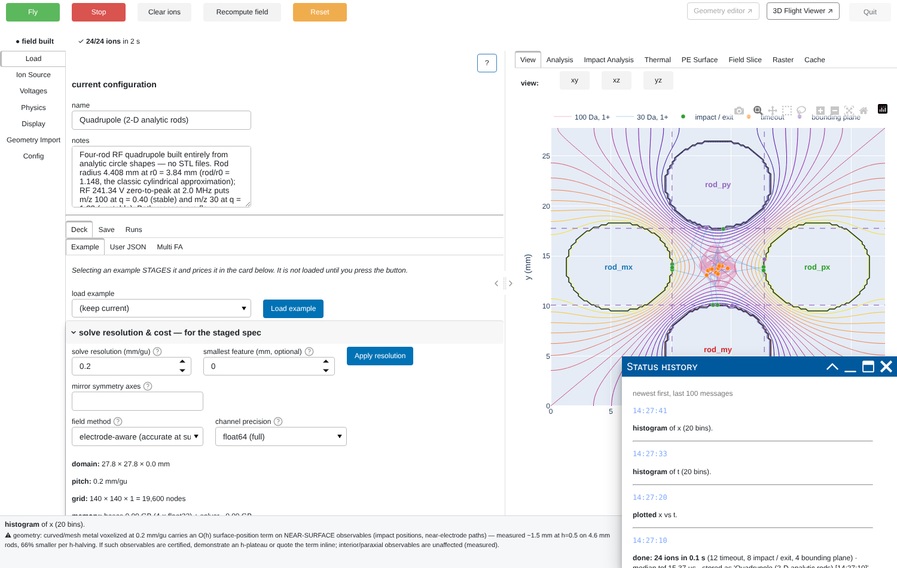

*Status History after flying Quadrupole (2D, analytic): the run log names the solve, the fly, and the fates.*

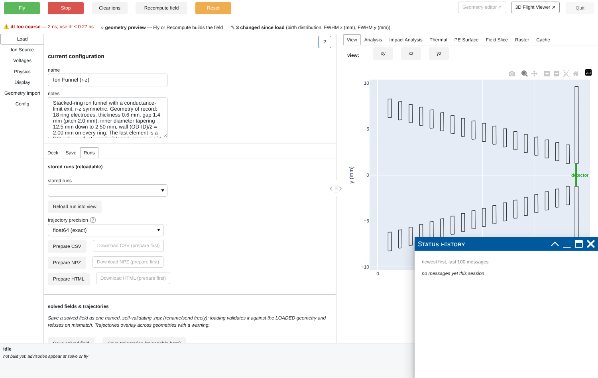

*The status bar runs along the bottom of every view and shows the latest message. History opens the session's full run log in a floating panel; errors open a dialog instead of scrolling past.*

- **History (Button) —** Open the session's status history in a floating panel.

The record-volume guard's verdicts land in the status bar (and on the fly chip in the top bar): the exact quote, the refusal or warning, and the levers (section 11). Two diagnostics live here too: ping → stdout prints one line to the server console — if the UI feels wedged, a ping that appears means the kernel is alive and the browser tab is the problem — and mem autolog logs the process's memory use to stdout every 30 s, which survives a wedged interface.

## Worked example captures

Each capture below is a real flight of a shipped example deck, driven through the dashboard by an automated screenshot pipeline. Nothing is mocked, and the set is regenerated after any UI change.

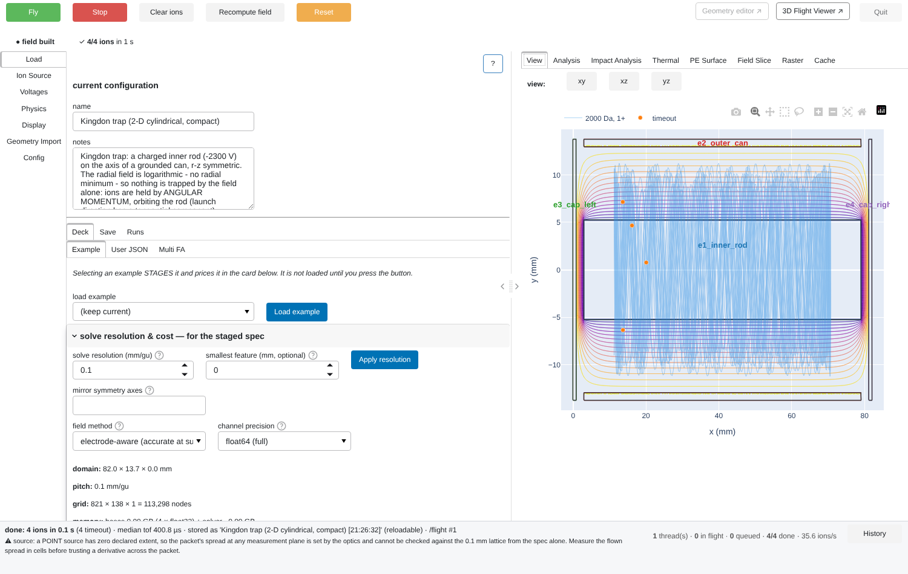

*Kingdon Trap (r-z): orbital motion around the central wire (0.65 r / 0.76 z rescale verified).*

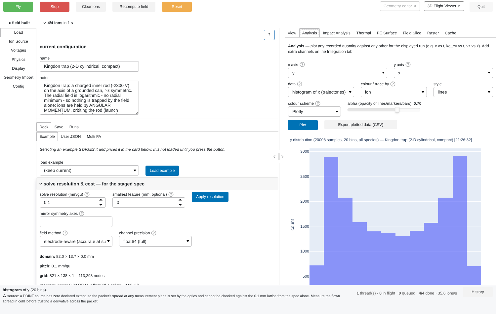

*Kingdon Trap (r-z): hist_traj -- the trajectory-sample histogram of the radius (y in r-z) -- the mode shipped for orbit dwell structure; the pile-up sits at the radial turning points.*

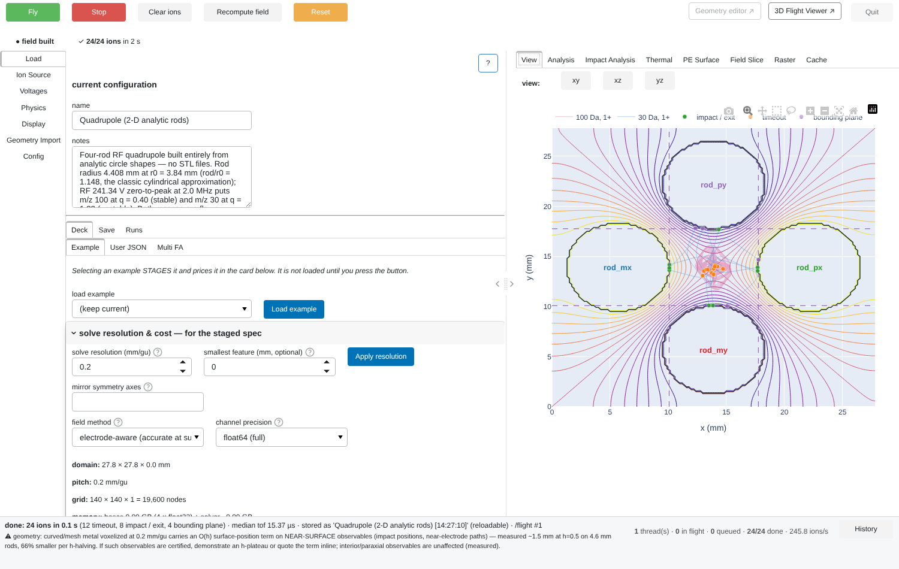

*Quadrupole (2D, analytic): stable and ejected masses in one fly -- the analytic rod field the toolkit ships. View pane, xy.*

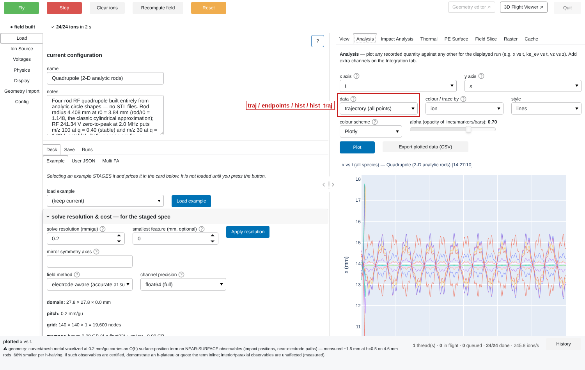

*Quadrupole (2D, analytic): Analysis tab, trajectory mode (every recorded point of every ion).*

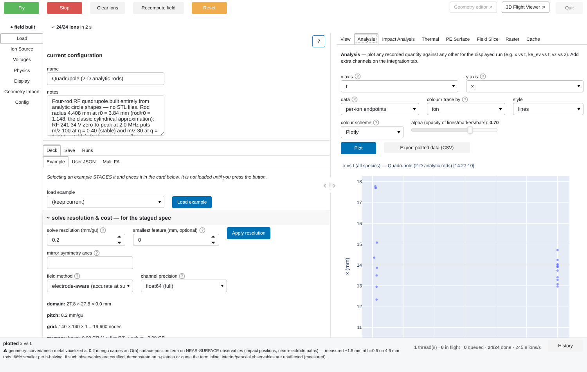

*Quadrupole (2D, analytic): Analysis tab, per-ion endpoints.*

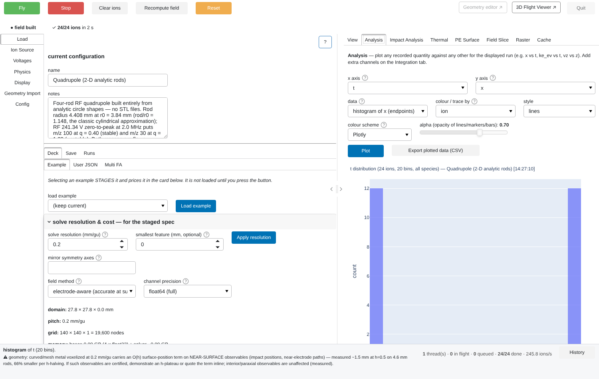

*Quadrupole (2D, analytic): Analysis tab, histogram over per-ion endpoints.*

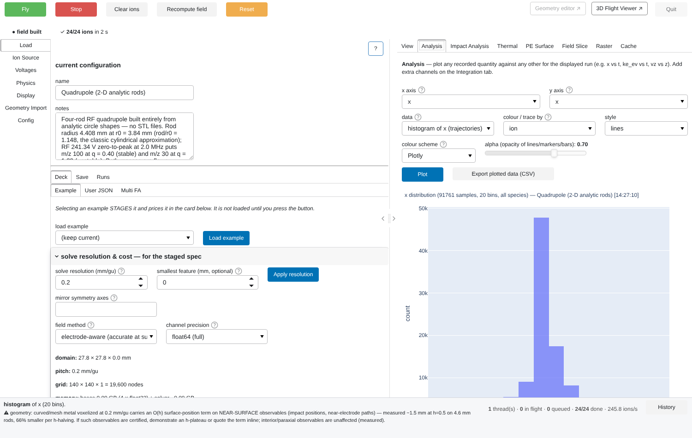

*Quadrupole (2D, analytic): Analysis tab, histogram over EVERY recorded sample (hist_traj) of x -- residence-weighted, so where an ion dwells in the confinement plane is where the counts are.*

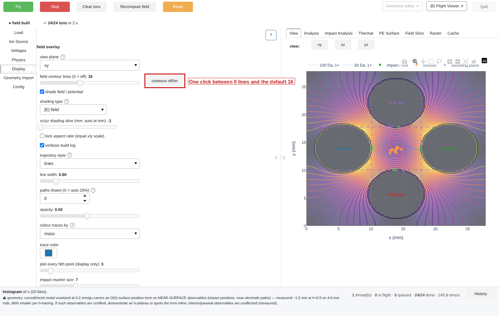

*Quadrupole (2D, analytic): the field overlay ON over the same flight -- Display tab, 'shade field / potential' ticked, contour slider at its default of 16. The shading is the instantaneous \|E\| the ions flew through; the contour lines make the rod quadrupole's saddle structure legible under the trajectories.*

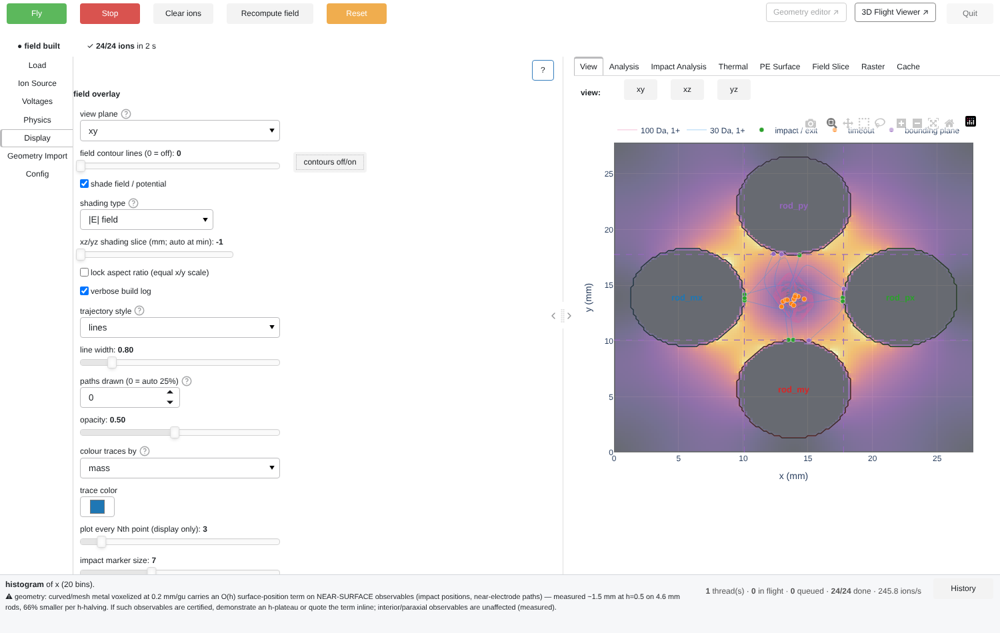

*Quadrupole (2D, analytic): the contours off/on button after one click -- the shading stays, the lines go, and the slider (the single value authority) now reads 0. A second click restores the default 16; dragging the slider sets any count in between.*

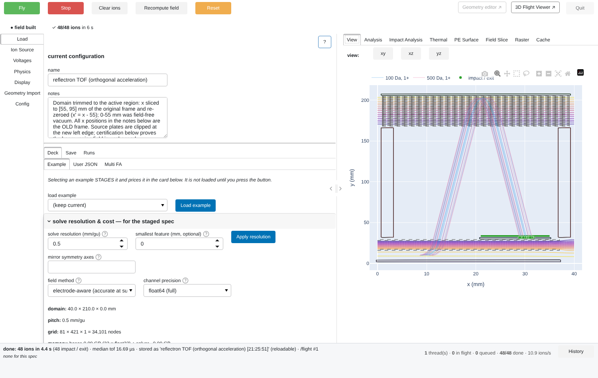

*Reflectron oa-TOF (2D): orthogonal acceleration, the field-free drift, the ion mirror turnaround and the return to the detector plate, all in one View-pane capture of a real fly (m/z 100 and 500). Electrode labels are turned off here (Display tab checkbox) -- this stack is dense enough that the tags crowd the beam; your own session shows them by default.*

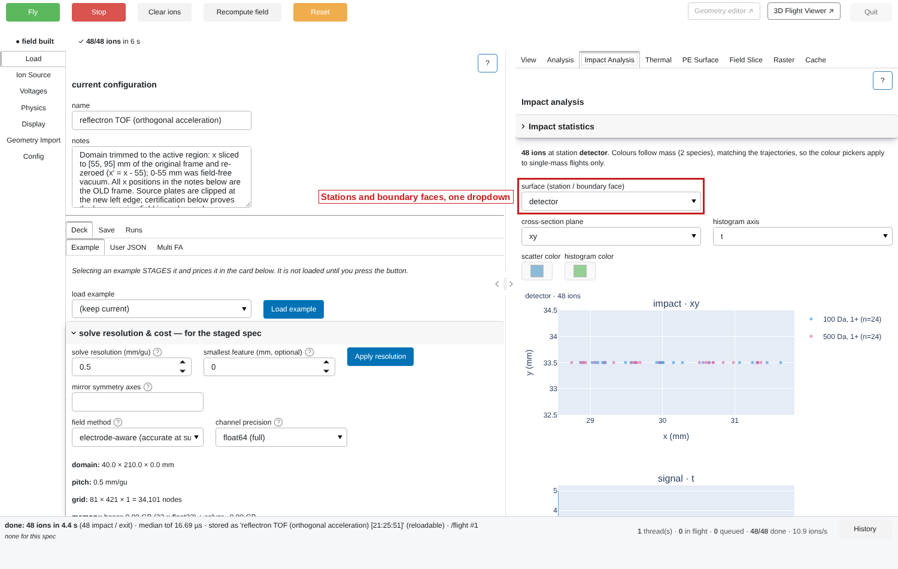

*Reflectron oa-TOF (2D): Impact Analysis at the deck's detector station on the plate face (y = 33.5 mm, windowed to the 21-35 mm plate span). The impact-xy cross-section shows where the packet lands across the plate (this deck is planar, so z is identically zero); the signal-vs-t histogram of the same arrivals is the mass spectrum -- two masses, two peaks.*

## 13.1 The geometry editor (/editor)

**What it is.** The dashboard's Geometry editor button opens /editor in a new tab, served by the same process. It edits the DECK: a shape is selected by electrode and index, its numbers are typed in millimetres or dragged with the gizmo, and Save writes the JSON back to the path shown at the bottom of the panel. The scene is the metal as the solver will rasterize it, not a sketch of it.

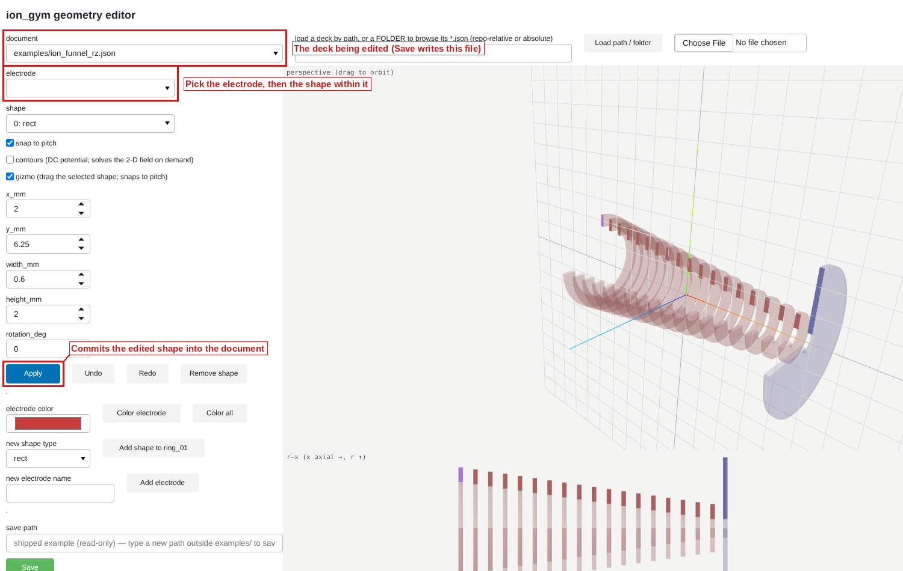

*The geometry editor (/editor), opened on the ion funnel deck: the shape being edited is picked by electrode and index on the left, the perspective scene shows the metal as the solver will rasterize it, and the panel beneath it is the r-x section with the axial coordinate horizontal. Edits are applied to the document, not to a copy: Save writes the deck back to the path shown at the bottom.*

**Snap to pitch.** With snapping on, a dragged shape lands on the solve lattice rather than between nodes. This matters for the same reason the lattice is declared rather than inferred: metal edges rasterize onto the grid, so an edge dropped half a cell off is a different instrument from the one you meant to draw. Undo and Redo step the document's edit history, and the editor refuses an edit it cannot represent rather than silently rounding it.

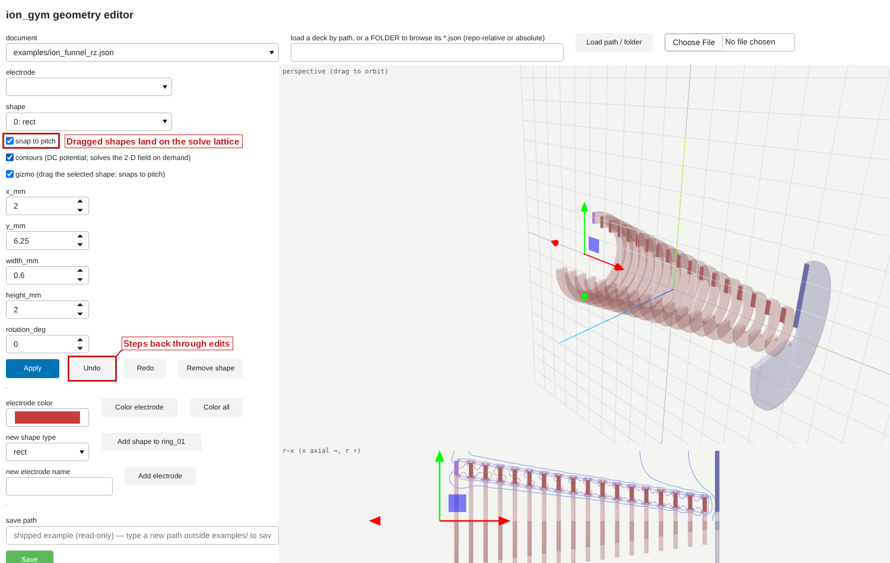

*Snap-to-pitch and the drag gizmo: with 'snap to pitch' on, a dragged shape lands on the solve lattice rather than between nodes -- the editor's way of keeping metal edges where the rasterizer will actually put them. Undo and Redo step the document's edit history.*

**Contours in the editor.** Ticking contours solves the two-dimensional DC field for the current document on demand and draws the equipotentials over the section, so the effect of moving an electrode is visible before the deck is ever flown. The editor states what it drew — for the ion funnel below, 494 contour lines across 15 levels, field build 0.318 s — and states equally plainly that these are DC potentials only, with RF drives excluded.

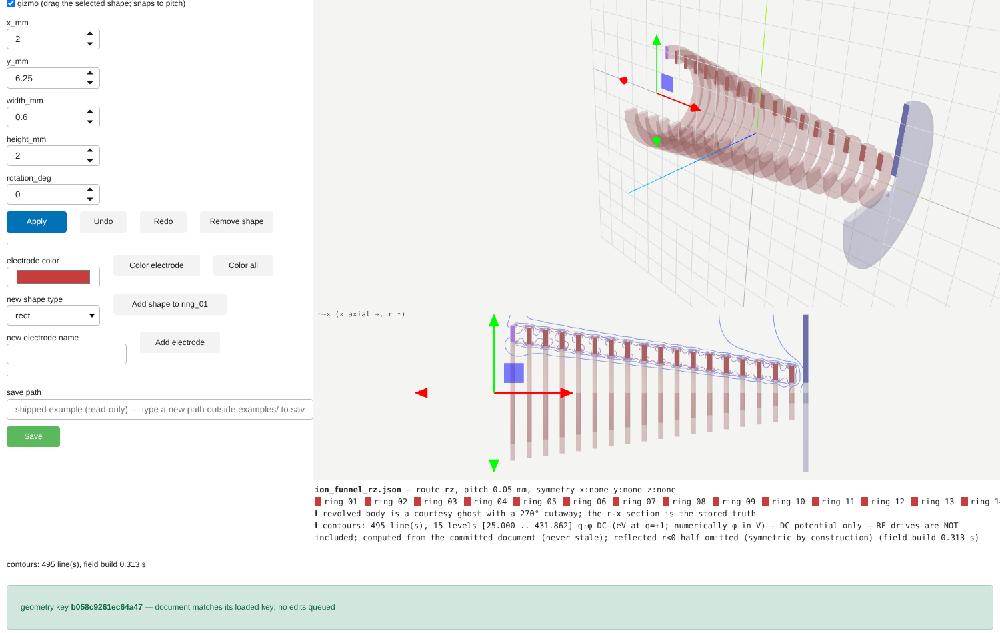

*The editor's own contour overlay: ticking 'contours' solves the 2-D DC field for the deck on demand and draws the equipotentials over the section, so the effect of moving an electrode is visible in the editor before the deck is ever flown.*

## 13.2 The 3-D Flight Viewer (/flight)

**What it is.** The 3D Flight Viewer button opens /flight, a read-only view of the LAST flight banked by the dashboard. Fly something, switch to the viewer, press Refresh, and the flown paths appear inside the instrument's electrodes in a scene you can orbit and zoom. The header states which record is being shown and how many paths were retained of those flown, so a thinned view can never be mistaken for the whole flight.

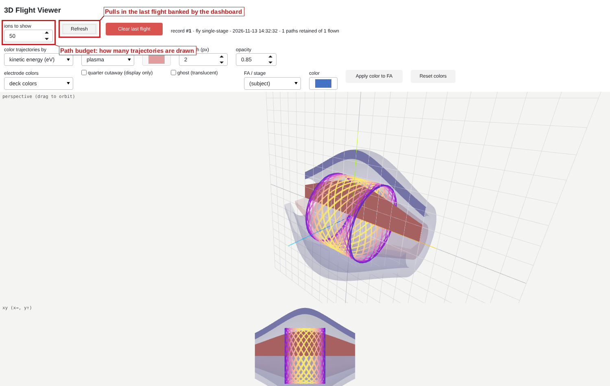

*The 3-D Flight Viewer (/flight) on Orbitrap (r-z): the orbits flown in the dashboard, drawn in a rotatable scene with the trap's electrodes. The viewer reads the LAST banked flight -- fly in the dashboard, then press Refresh here. Trajectories are colored by kinetic energy on the plasma scale by default; drag to orbit, scroll to zoom, and the perspective is remembered per document across a refresh.*

**Why a second angle.** A single projection of a three-dimensional scene hides an axis. The Orbitrap paths below are the same flight seen after dragging the camera through roughly a quarter turn: the first view shows the orbital motion around the spindle, the second shows the axial oscillation along it, and the instrument is only legible as both at once. The perspective is remembered per instrument, so a refresh returns to the view you left.

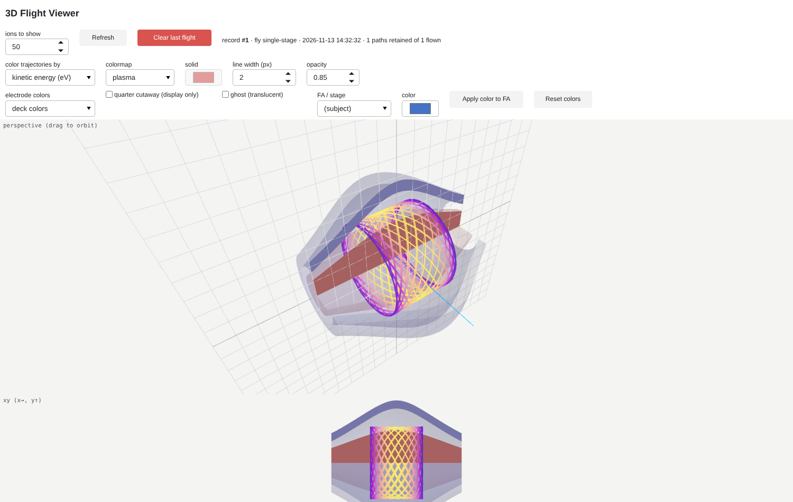

*The same Orbitrap (r-z) flight after dragging the camera through roughly a quarter turn. A single projection of a 3-D scene hides an axis: here the second angle is what shows the orbits winding along the wire rather than simply circling it.*
