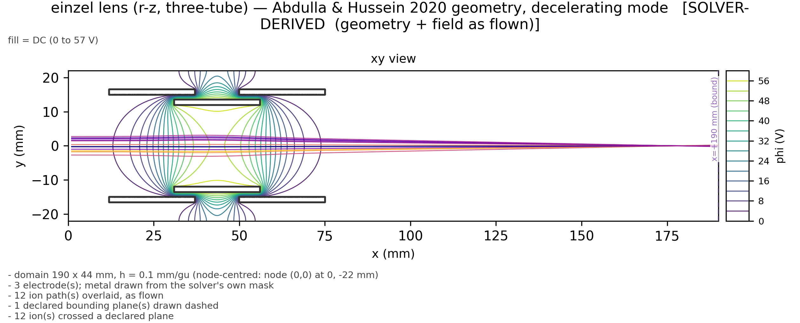
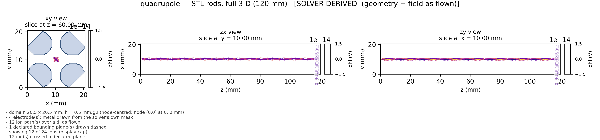

<!-- Generated from the ion_gym user manual and the shipped decks and notebooks. Edits made here are overwritten. -->

# 4. Geometry

## 4.1 Declared primitives

The simplest geometries are built from declared shapes — boxes, cylinders, and their unions and differences — attached to named electrodes. Each electrode carries a name, an index, a DC voltage, and optionally the name of an RF group it belongs to. The name is not decoration: it is what the field maps, the legends and the analysis channels refer to.

*Figure 1. A round einzel lens declared as cylindrical (r-z) primitives. The shading is the solved potential; the outlined bodies are the electrodes exactly as the solver received them. The radial axis is drawn from −R to +R with the symmetry axis at zero.*

## 4.2 Importing STL meshes

When a shape cannot be expressed as primitives, it is imported as an STL mesh — one file per electrode. This is the escape hatch for real hardware: draw the part in SolidWorks, Onshape or CadQuery, export STL, and point the specification at it.

The specification declares a directory with stl_dir, and each electrode names its own file. The directory is resolved relative to the specification file, so a specification and its meshes move together.

    "geometry": {
      "mm_per_gu": 0.2,
      "stl_dir": "einzel_stl_plates",
      "electrodes": [
        {"index": 1, "name": "plate_1", "dc": 0.0,    "stl": "einzel3d_plate_1.stl"},
        {"index": 2, "name": "plate_2", "dc": -2000.0,"stl": "einzel3d_plate_2.stl"},
        {"index": 3, "name": "plate_3", "dc": 0.0,    "stl": "einzel3d_plate_3.stl"}
      ]
    }

Meshes are voxelized onto the same uniform grid as everything else. A mesh does not buy you sub-grid accuracy: a curved surface is represented by the grid cells it occupies, so the solver pitch still governs how faithfully a curve or a thin feature is captured. A feature thinner than about two grid cells is not reliably resolved, and a mesh with holes or flipped normals may voxelize to something that is not what you drew. Preview the voxelization (Geometry Import tab) before trusting a mesh: what you see there is literally what the solver will solve.

Because the geometry is only as trustworthy as the files behind it, the toolkit records a SHA-256 hash of every STL a specification references. The preflight check compares the files on disk against those hashes and refuses to proceed on a mismatch, rather than silently solving a geometry that is no longer the one the specification describes.

*Figure 2. A quadrupole imported from STL rod meshes and solved as a full 3-D geometry, shown in three orthogonal projections. Any geometry with genuine depth is presented multi-axis: a single projection hides exactly the off-axis structure one needs to see.*

## 4.3 File organization

A simulation is a directory, not a single file. The convention is:

    my_instrument/
      instrument.json          <- the specification
      stl/                     <- meshes named by electrode
         plate_1.stl
         plate_2.stl
      births.csv               <- optional explicit ion start conditions

Keep the specification at the root of its own directory and reference resources with relative paths. Absolute paths make a specification unusable on any other machine, and are the single most common reason a shared simulation fails to load. Solved fields are cached separately, outside the specification directory, and are regenerated on demand — they are not part of what you share.

A project folder holding several devices, their meshes and custom birth files can grow complex, but one JSON file remains all that is needed to reproduce a result for a single instrument.

## 4.4 Symmetry and mirror planes

If a geometry is symmetric about a plane, only half of it need be stored and solved. A declared mirror axis halves the memory and roughly halves the solve time, and the solver reflects the appropriate boundary condition at that plane.

Symmetry is **declared, never assumed**. The toolkit will not detect symmetry for you, because a geometry that looks symmetric may not be symmetric in its voltages (e.g. a hexapole), and solving the wrong half is a silent error. A mirrored axis is displayed from −H to +H with the mirror plane at zero, so a coordinate you write in the specification is measured from the plane of symmetry and read back the same way.
