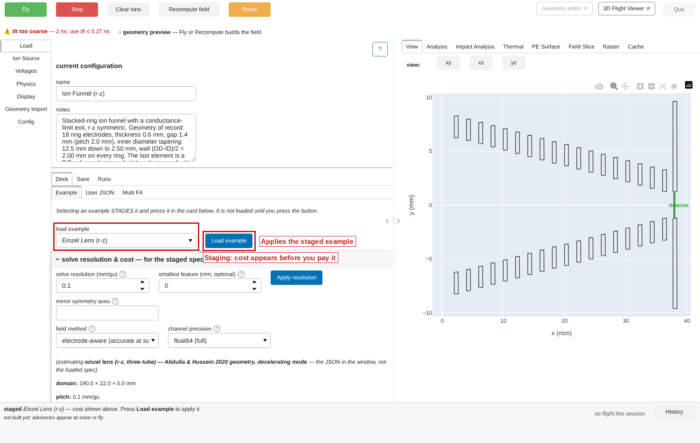
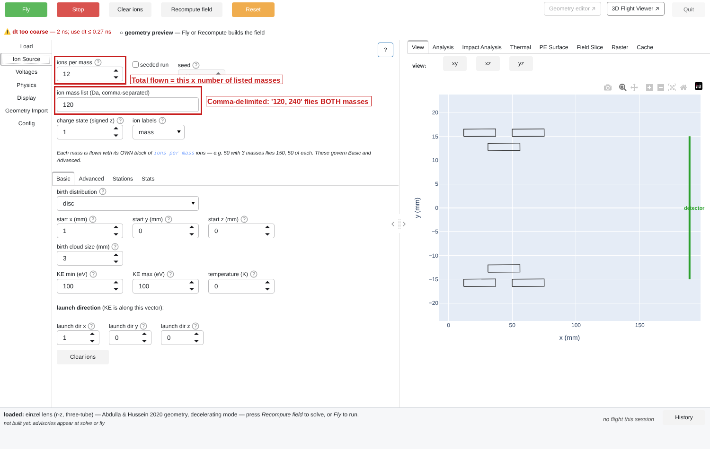
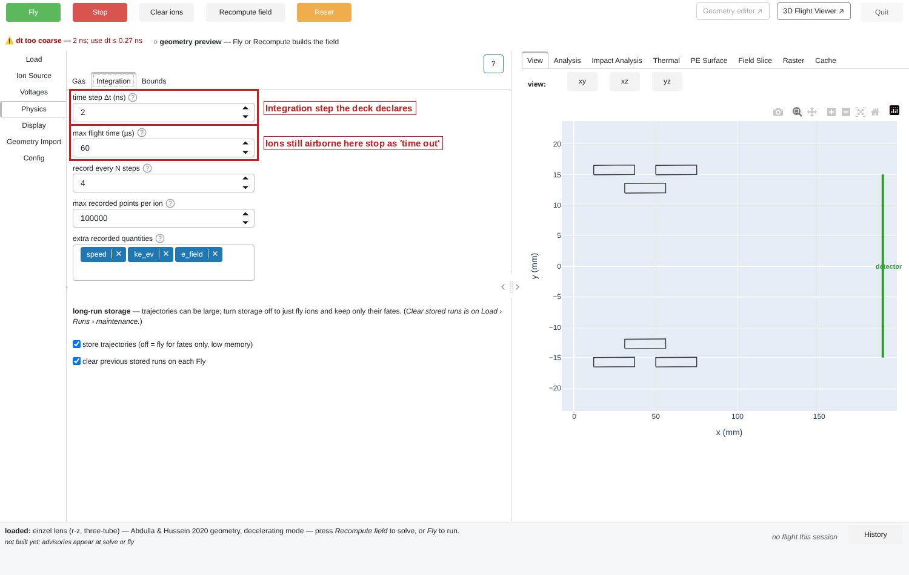
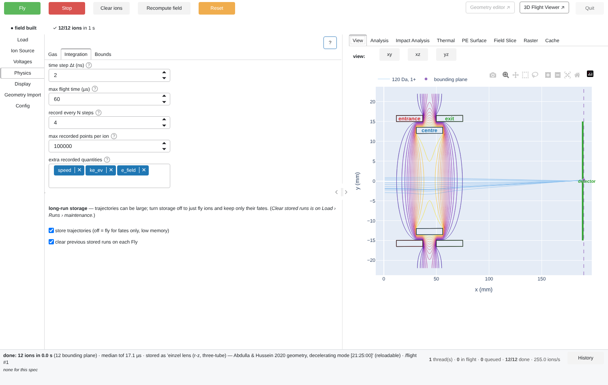
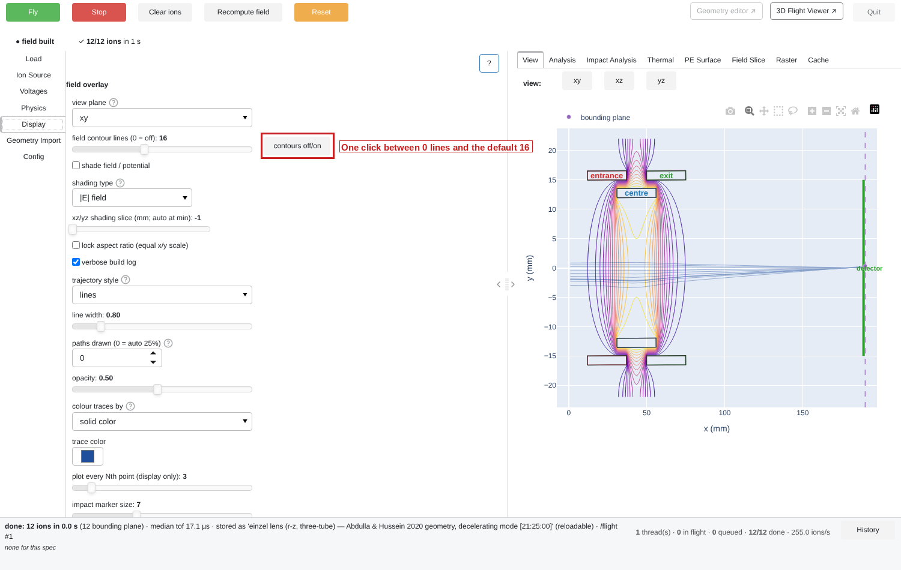
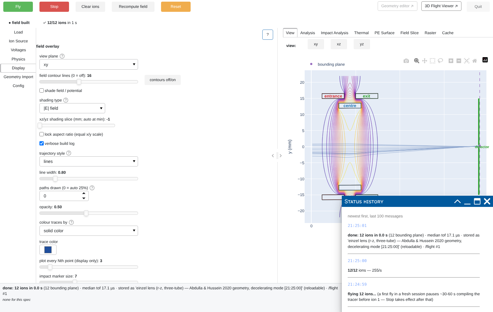

<!-- Generated from the ion_gym user manual and the shipped decks and notebooks. Edits made here are overwritten. -->

# 2. Quick start

## 2.1 Installation

The toolkit installs as a normal Python package from the repository root. The core package needs only the scientific stack; the browser application and the notebooks pull extra dependencies, grouped as extras:

    python -m pip install -e .              # core only
    python -m pip install -e ".[editor]"    # + the browser application
    python -m pip install -e ".[notebooks]" # + the teaching notebooks
    python -m pip install -e ".[all]"       # everything

The first run after installation is slower than every later one: the physics kernels compile on first use and are cached to disk, and field solves are banked so a repeated build is a cache hit. Nothing needs to be configured. The one thing written outside the repository is the solved-field cache, in ~/.ion_gym_cache by default; set the ION_GYM_CACHE environment variable to move it.

A minimal session loads a specification, builds the field, and flies ions:

    from ion_gym.io.sim_spec import SimSpec
    from ion_gym.physics.sim_build import build_run
     
    spec = SimSpec.from_json('examples/einzel_round_r-z.json')
    model, fly, col_names, births = build_run(spec, verbose=True)
     
    traj, summary = fly(0)          # fly ion 0
    print(col_names)                # what the columns of traj mean
    print(summary['tof'], summary['kind'])

Load specifications by **path**, not by pasting their text. A specification loaded from a path records where it came from, so relative resources — an STL directory, a births file — resolve against the specification rather than against your current working directory. This is what makes a specification plus its resources portable.

The returned fly is a function: calling fly(i) flies ion i and returns its trajectory array and a summary dictionary. Building the model and flying ions are separate steps because the field is expensive and the flight is cheap; one solved field serves any number of ions. In the summary, tof is when the flight ended and kind is the numeric fate code saying how — section 9 lists the vocabulary (for this deck every ion ends on the declared bounding plane, kind 3).

## 2.2 Viewing the trajectories

A raw trajectory array is rarely what you want to look at as a table. However, to view the flight, hand the flown paths back to the framework's own renderer — the same path every figure in this manual took:

    from ion_gym.viz.viz_core import scene_from_simspec, report
     
    trajs, fates = [], []
    for i in range(len(births)):
        tr, summ = fly(i)
        if tr is not None and len(tr):
            trajs.append(tr)
            fates.append(str(summ.get('kind', '')))
     
    sc = scene_from_simspec(spec, model, field='phi',
                            trajs=trajs, fates=fates)
    report([sc], 'outputs/einzel_quickstart', name='einzel quickstart')

The report draws the electrodes as solved, the equipotentials of the field the ions actually flew through, and every path colored by how its flight ended — and for a three-dimensional model it does so in each principal plane, because a single projection of a 3-D instrument hides exactly the off-axis behavior you are usually looking for.

## 2.3 The same flight in the application — a worked example

The application runs the identical loop with buttons instead of code. This walk uses the same shipped deck the script above loads — “Einzel Lens (r-z)” — and every screenshot below is a real capture of that session, one figure per step.

The window has three parts. The control tabs run down a rail on the left in workflow order, starting with Load, and each tab has a ? button that opens a short note on what it is for. The plot pane sits on the right, and the divider between the two can be dragged. Two lines across the top hold the action buttons and, under them, chips that state the time-step verdict, whether the field is built or only previewed, how many controls differ from the deck as loaded (each such control is outlined), and the progress of the last flight. The status bar runs along the bottom. A failure that needs attention opens a dialog with the full message and a copy button rather than scrolling past in the log. Reset returns the session to the deck it opened with.

The dashboard opens on the Ion Funnel (r-z) example. That deck is a balance of speed and function. It shows the full chain of RF confinement, a DC ladder and hard-sphere collisions in 2.5 Torr N₂, but its 2 ns step is coarser than the gas and RF physics call for. The red “dt too coarse” note at the top of the window says so, and it is correct for that pressure. It names the step (about 0.27 ns) that resolves the collisions and the RF. Use that step, at a correspondingly longer run, before quoting numbers from the funnel.

**Step 1 — load the deck.** Open the Load tab, the first in the rail, and its Deck \> Example sub-tab, and pick “Einzel Lens (r-z)” in the example loader — picking stages the example and shows its solve cost before you commit — then press Load example.

*Step 1 -- Load tab, Deck \> Example: pick Einzel Lens (r-z) in the example loader. Selecting STAGES the example and shows its solve cost before you commit; the Load example button applies it.*

**Step 2 — check the ion source. The Ion Source tab now shows what the deck declares: 12 ions born on a 3 mm disc, 100 eV along +x, at *m/z* 120. The ion mass list is comma-delimited: “120” flies one mass; typing “120, 240” flies a full block of ions at each listed mass — the total flown is “ions per *m/z*” times the number of values in the list. The charge state is its own signed integer beside the list: the mass list carries masses in daltons, not mass-to-charge ratios.**

*Step 2 -- Ion Source tab after loading Einzel Lens (r-z): the deck declares 12 ions on a 3 mm disc at 100 eV along +x, m/z 120. The m/z list is COMMA-DELIMITED: '120' flies one mass; '120, 240' flies a full block of ions at each listed mass.*

**Step 3 — check the flight conditions.** The Physics tab carries the integration conditions the deck ships: a 2 ns time step, a 60 µs maximum flight time, and collisions off (vacuum). What this tab shows is what the integrator receives.

*Step 3 -- check the flight conditions. The Physics tab's Integration sub-tab carries the conditions Einzel Lens (r-z) ships with: a 2 ns time step and a 60 µs flight-time ceiling. Collisions live on the Gas sub-tab beside it and are off for this deck (vacuum). What these fields show is what the integrator receives.*

**Step 4 — press Fly.** The solve runs first (about ten seconds for this geometry; its progress prints to the status bar at the bottom), the ions fly, and the trajectories draw over the solved geometry in the View pane; xy / xz / yz projections are one click apart, and the 3D Flight Viewer opens the same paths in a rotatable scene.

*Step 4 -- press Fly: the trajectories draw over the solved geometry in the View pane (the one-button form of the section 2.1 script). xy / xz / yz projections are one click apart, and the 3D Flight Viewer opens the same paths in a rotatable scene.*

**Step 5 — show the field.** On the Display tab, the field contour lines draw the equipotentials the ions flew through, at the default count of 16, each line colored by its potential on the plasma scale. For this DC lens the potential energy of an ion is its charge times the potential, so the lines show the three-tube focusing structure directly. Ticking “shade field / potential” adds a color fill under the lines, which the figure for this step leaves off so the lines and the blue paths stay readable. The contours off/on button beside the slider flips the lines with one click, and the slider is the single value authority.

*Step 5 -- the potential the ions flew through: Display tab, field shading off and equipotential lines at the default 16, each coloured by its potential on the plasma scale, with the paths in blue. For this DC lens the potential energy of the ion is q times the potential, so the lines show the einzel's three-tube focusing structure directly; the contours off/on button flips the lines with one click.*

**Step 6 — read the result.** The status bar along the bottom shows the latest message, and its History button opens the full run log in a floating panel. The log names the solve, the fly, and the per-fate counts, the ground truth for what the flight did. For this deck expect all 12 ions to complete, every one ending on the bounding plane past the lens (the beam is focused through and exits the domain), with a median time of flight near 17 µs. The Analysis tab plots any recorded channel against any other for the same run (press Plot after choosing).

*Step 6 -- the expected result, in the status History panel: the solve, the fly, and the per-fate counts for the 12 ions. This log is the ground truth the chapter-2 prose quotes.*
