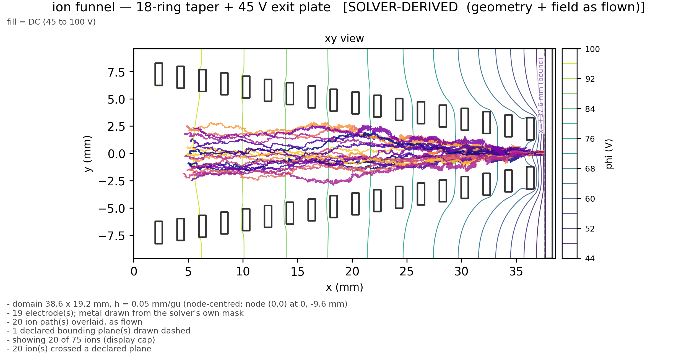

<!-- Generated from the ion_gym user manual and the shipped decks and notebooks. Edits made here are overwritten. -->

# 8. The pseudopotential view

An RF field exerts a net focusing force on an ion because the field is inhomogeneous: over one RF cycle the ion spends slightly longer where the field is weaker. Averaged over the cycle this is equivalent to a static effective potential — the pseudopotential of Dehmelt **\[5\]** — of magnitude

V\* = q E₀² / (4 m Ω²)

where E₀ is the amplitude of the RF field at that point, m the ion mass, and Ω the angular drive frequency. The toolkit displays the sum of the DC potential energy and this term as an effective potential-energy surface, which is the natural way to see where ions are confined and how deep the well is.

This picture is an approximation and the flight is not. Trajectories are always integrated in the real time-varying field; the pseudopotential is a visualization. It is valid in the adiabatic limit, where the field changes little over one RF period as seen by the ion — the condition quantified by the adiabaticity parameter of Gerlich **\[6\]**. It degrades where the field is strongly inhomogeneous over a micromotion amplitude, near electrode surfaces, at low *m/z*, and near the edges of stability. When the pseudopotential says an ion is confined and the trajectory says it is lost, the trajectory is the answer.

*Figure 3. An electrodynamic ion funnel \[7\]: a stack of ring electrodes of decreasing aperture, driven with RF on alternating rings and a DC gradient along the axis. The RF confines ions radially through the pseudopotential while the DC pushes them forward; the geometry is the solver's own electrode mask, not a schematic.*
